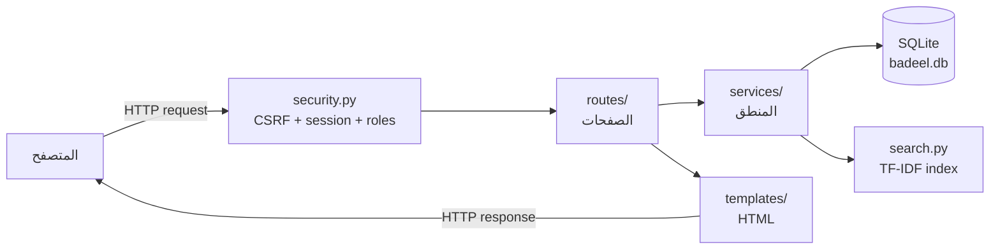
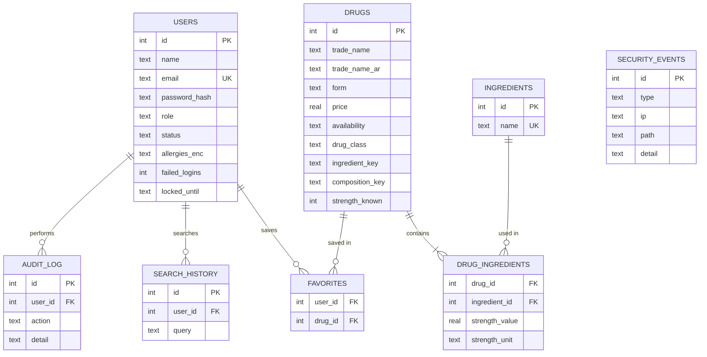

# شرح مشروع «بديل» بالكامل: إيه اللي اتعمل، إزاي، وليه

الملف ده مكتوب علشان أي واحد في الفريق يقدر يشرح أي جزء قدام اللجنة.
اقرأه مرة والكود مفتوح جنبك.

---

## 1. الفكرة في سطرين

المستخدم يكتب اسم دواء. السيستم يفهم الاسم حتى لو فيه غلطة، يجيب الدواء،
ويعرض كل الأدوية اللي ليها **نفس المادة الفعالة ونفس التركيز ونفس الشكل
الدوائي**، المتوفر أولًا ثم الأرخص.

## 2. التكنولوجي المستخدمة وليه

| الجزء | الاختيار | السبب |
|---|---|---|
| لغة الـ backend | Python | نفس لغة الـ ML، فالموقع والموديل في مشروع واحد |
| الـ framework | Flask | صغير وواضح: كل صفحة = دالة واحدة. أسهل في الشرح من Django |
| قاعدة البيانات | SQLite | ملف واحد، من غير تسطيب سيرفر، مناسب للعرض على اللابتوب |
| الـ ML | scikit-learn (TF-IDF) | مكتبة قياسية، سريعة، ونتيجتها قابلة للشرح |
| التشفير | cryptography (Fernet) | تشفير AES جاهز وآمن بدل ما نكتب تشفير بإيدينا |
| الواجهة | HTML + CSS + JavaScript عادي | من غير React: مفيش build ومفيش تعقيد، والصفحات تشتغل حتى لو الـ JS مقفول |

**ملحوظة مهمة عن قاعدة البيانات:** الكود بيكلم SQLite مباشرة بـ SQL عادي
(من غير ORM). ده معناه إنكم تقدروا تشرحوا كل query. لما تيجوا ترفعوا الموقع
أونلاين وتحولوا لـ PostgreSQL، التغيير هيبقى في ملف `db.py` وشوية فروق في
صيغة الـ SQL (مكتوبة في القسم 10). كل الـ SQL موجود في أماكن قليلة فالتحويل
محدود، بس هو شغل حقيقي ومش سطر واحد.

## 3. معمارية السيستم (Architecture)



الكود مقسوم 3 طبقات، وكل طبقة ليها شغلانة واحدة:

1. **routes/** : تستقبل الطلب، تتأكد من الصلاحية، تنادي المنطق، وترجع صفحة.
   مفيهاش منطق دوائي.
2. **services/** : المنطق نفسه (توحيد النصوص، المطابقة، البحث، الاستيراد).
   مفيهاش أي حاجة عن HTML.
3. **db.py + schema.sql** : التخزين.

ليه التقسيم ده؟ علشان لو غيرتوا شكل الصفحة مش هتلمسوا منطق المطابقة، ولو
غيرتوا قاعدة البيانات مش هتلمسوا الصفحات. وعلشان الاختبارات تقدر تختبر
المنطق لوحده.

### رحلة طلب واحد (مثال: المستخدم فتح صفحة دواء)

1. المتصفح يطلب `/drug/17`.
2. `before()` في `__init__.py` تشتغل قبل أي صفحة: تحدد اللغة، تحمّل المستخدم
   من الـ session، وتتأكد من الـ CSRF لو الطلب POST.
3. Flask يوصل الطلب للدالة `drug()` في `routes/public.py`.
4. الدالة تجيب الدواء من الجدول، وتنادي `recommender.get_alternatives()`.
5. النتيجة تروح لـ `templates/drug.html` اللي بيرسم الصفحة.
6. `set_security_headers()` تضيف هيدرز الأمان على الرد.

## 4. تصميم قاعدة البيانات (ERD)



### ليه الجداول دي بالشكل ده؟

- **drugs و ingredients جدولين منفصلين وبينهم drug_ingredients.**
  الدواء الواحد ممكن يبقى فيه أكتر من مادة فعالة (أوجمنتين = Amoxicillin +
  Clavulanic acid)، والمادة الواحدة موجودة في أدوية كتير. دي علاقة
  many-to-many، وحلها القياسي جدول وسيط. لو حطينا المواد كنص في عمود واحد
  مكناش هنعرف نسأل «هات كل الأدوية اللي فيها Amoxicillin».
- **`composition_key` و `ingredient_key` في جدول drugs.**
  دول مفتاحين محسوبين وقت الحفظ. مثال:
  `composition_key = "amoxicillin:875mg|clavulanic acid:125mg"`.
  بقت المطابقة مجرد `WHERE composition_key = ? AND form = ?`، وعليها index،
  فالبحث عن البدائل سريع حتى مع عشرات الآلاف من الأدوية. (ده اسمه
  denormalization مقصود: بنخزن قيمة محسوبة علشان السرعة.)
- **`strength_known`.** لو الدواء اتسجل من غير تركيز، ممنوع يطلع كبديل
  مطابق لأي حاجة. أمان المريض أهم من إننا نعرض نتيجة.
- **`password_hash` مش `password`.** كلمة المرور نفسها مش متخزنة في أي حتة.
- **`allergies_enc`.** بيانات صحية، متخزنة مشفرة.
- **security_events و audit_log جدولين مختلفين.** الأول للهجمات (محاولات
  دخول فاشلة، honeypot). التاني لتغييرات المستخدمين الشرعيين (مين غيّر سعر
  إيه). الفصل بينهم بيخلي مراجعة كل واحد أسهل.
- **`ON DELETE CASCADE`.** لو دواء اتمسح، مكوناته والمحفوظات المرتبطة بيه
  بتتمسح معاه تلقائيًا، فمفيش صفوف يتيمة.

## 5. قلب المشروع: منطق المطابقة

الملفات: `services/normalize.py` و `services/recommender.py`.

### المشكلة

الداتا الحقيقية بتكتب نفس الحاجة بطرق مختلفة:

```
Paracetamol 500mg      ACETAMINOPHEN 0.5 g      paracetamol (500 mg)
```

التلاتة دول نفس الدواء. المقارنة النصية المباشرة هتقول إنهم مختلفين.

### الحل: التوحيد (Normalization) قبل المقارنة

`normalize.py` بيحوّل كل صيغة لشكل واحد قياسي:

| الخطوة | مثال |
|---|---|
| حروف صغيرة + إزالة المسافات الزيادة + توحيد الحروف العربية (أ إ آ ← ا) | `PARACETAMOL ` ← `paracetamol` |
| حذف ما بين الأقواس | `Amoxicillin (as trihydrate)` ← `amoxicillin` |
| الأسماء البديلة من `data/aliases.csv` | `acetaminophen` ← `paracetamol` |
| حذف hydrochloride / HCl | `metformin hcl` ← `metformin` |
| توحيد وحدات الكتلة إلى mg | `0.5 g` ← `500mg` و `100 mcg` ← `0.1mg` |
| توحيد التركيز لكل 1 ml | `100 mg/5 ml` ← `20mg/ml` |
| توحيد الشكل | `F.C. Tabs` و `أقراص` و `Caplets` ← `tablet` |
| تمييز ممتد المفعول | `Tablets XR` ← `tablet (extended release)` |
| ترتيب المواد أبجديًا | `Clav + Amox` = `Amox + Clav` |

بعد التوحيد، المقارنة بقت `==` عادية.

**قرار مقصود:** الأملاح زي sodium و potassium **مش** بتتحذف. Diclofenac
sodium (فولتارين) و Diclofenac potassium (كتافلام) بيتعاملوا كمادتين
مختلفتين، لأن سرعة الامتصاص مختلفة. السيستم بياخد الجانب الآمن.

### التلات مستويات

`recommender.get_alternatives()` بترجع تلات قوايم:

1. **بدائل مطابقة:** نفس `composition_key` ونفس `form`. دي اللي ينفع تتصرف
   بدل الدواء مباشرة.
2. **نفس المادة بتركيز أو شكل مختلف:** نفس `ingredient_key` بس. بتتعرض
   لوحدها بتحذير، والجزء المختلف متلون في الصفحة. الجرعة لازم يحددها صيدلي.
3. **نفس المجموعة العلاجية:** مادة مختلفة من نفس الـ `drug_class`. «اسأل
   الدكتور عن دي» وبس.

الترتيب جوه كل قايمة: المتوفر، ثم غير المعروف، ثم الناقص. وجوه كل مجموعة
الأرخص أولًا.

### السؤال اللي اللجنة هتسأله: «ليه المطابقة قواعد مش AI؟»

الإجابة:

> الاقتراح الغلط ممكن يأذي مريض. المطابقة مسألة ليها إجابة صح واحدة ومعروفة:
> المادة والتركيز والشكل يا متطابقين يا لأ. الموديل الإحصائي بيدّي إجابة
> «غالبًا صح»، وده مش مقبول هنا. فاستخدمنا قاعدة ثابتة ممكن أي صيدلي
> يراجعها، واستخدمنا الـ ML في المكان اللي الغلط فيه مش خطر: فهم اللي
> المستخدم كتبه. وده نفس المبدأ المستخدم في الأنظمة الطبية الحقيقية:
> القرار الحرج يبقى deterministic وقابل للتدقيق.

## 6. جزء الـ ML: البحث الذكي

الملف: `services/search.py`.

### المشكلة

المستخدم بيكتب «اوجمنتن» أو «ogmentin» أو «بنادول». البحث العادي
(`LIKE '%...%'`) مش هيلاقي حاجة لأن الحروف مش متطابقة.

### الحل: TF-IDF على character n-grams + cosine similarity

1. كل دواء بيتحول لـ «مستند» نصي: الاسم الإنجليزي + الاسم العربي + المواد
   الفعالة.
2. المستند بيتقطع لقطع متداخلة من 2 إلى 4 حروف. `panadol` ←
   `pa, an, na, ad, do, ol, pan, ana, nad, ...`
3. **TF-IDF** بيدي كل قطعة وزن: القطعة النادرة (المميزة لدواء معين) وزنها
   عالي، والقطعة اللي موجودة في كل الأسماء وزنها قليل.
4. كل دواء بقى vector من الأرقام. والكلمة اللي المستخدم كتبها بتتحول
   لـ vector بنفس الطريقة.
5. **Cosine similarity** بتقيس الزاوية بين الـ vectors. `panadol` و `pandol`
   مشتركين في معظم القطع، فالزاوية صغيرة والتشابه عالي.
6. بنرتب الأدوية بالتشابه ونرجع الأعلى.

إضافتين صغيرتين: لو الاسم بيبدأ بالظبط باللي المستخدم كتبه بياخد bonus
(علشان `pan` تجيب Panadol أول حاجة)، ولو المستخدم كتب اسم بديل لمادة
(`acetaminophen`) بيتحول للاسم القياسي قبل البحث.

الـ index بيتبني مرة واحدة ويتخزن في الذاكرة، وبيتعاد بناؤه تلقائيًا لما
الداتا تتغير (عن طريق `data_version` في جدول settings).

### الموديل المتدرب اللي بيرتّب النتايج (`badeel/services/ranker.py`)

الـ TF-IDF بيجيب أقرب 30 دوا، وبعدين موديل **Logistic Regression** بيعيد
ترتيبهم. لكل دوا مرشح بنحسب 12 رقم (features) زي: درجة الـ TF-IDF، تشابه
أول جزء من الاسم (stem_sim)، هل الأرقام اللي كتبها المستخدم (400، 500)
موجودة في اسم الدوا ولا مختلفة (number_mismatch)، هل الاسم بيبدأ بنفس الحروف.

**التدريب من غير labeling (self-supervised):** بناخد كل اسم دوا ونعمل فيه
غلطات بقصد من 6 أنواع (حرف واحد، حرفين، لوحة المفاتيح، نطق، أول الاسم بس،
عربي)، فبنعرف الإجابة الصح لكل سؤال من غير ما حد يصنّف حاجة بإيده.

**الاختبار عادل:** cross-validation بـ 5 أجزاء متقسمة حسب اسم الماركة، يعني
الموديل بيتختبر على ماركات ما شافهاش وهو بيتدرب.

| | الدوا الصح أول نتيجة (Top-1) |
|---|---|
| الداتا المصرية (1,500 دوا، 18,000 سؤال) من غير الموديل | 83.0% |
| الداتا المصرية مع الموديل | **93.0%** (Top-3 97.3%، MRR 0.952) |
| البيانات التجريبية (59 دوا) من غير / مع الموديل | 95.5% / 97.1% |

أهم وزنين: `stem_sim` (+4.78) و `number_mismatch` (−3.91). الموديل متخزن
JSON في `instance/search_model.json` مش pickle (الـ pickle ممكن يشغّل كود).
التدريب: `python manage.py train-model` أو زرار في لوحة الأدمن؛ والمقارنة مع
Random Forest و Gradient Boosting: `python ml/train.py --compare`.

**ليه مش deep learning؟** الداتا أسماء قصيرة مش جُمل، والموديل البسيط بيوصل
93% وبيشتغل في أقل من 1 ميلي ثانية وتقدر تشرح كل وزن فيه. الخطوة الجاية
(Future Work): يتعلم من سجل البحث الحقيقي (المستخدم كتب إيه وفتح إيه).

### التقييم: `python ml/evaluate.py`

السكريبت بيقيس حاجتين:

1. **البحث:** بياخد كل اسم دواء ويعمل فيه غلطة عشوائية (حذف حرف، تبديل
   حرفين، حرف غلط، حرف زيادة) ويشوف الدواء الصح رجع ولا لأ. بيطلع
   Top-1 accuracy و Top-3 و MRR، وبيقارن ببحث `LIKE` العادي كـ baseline.
2. **المطابقة:** ملف `data/gold_pairs.csv` فيه 40 زوج أدوية متصنفين يدويًا
   (بديل / مش بديل). السكريبت بيقارن قرار السيستم بالتصنيف وبيطلع
   Accuracy, Precision, Recall, F1 والـ confusion matrix. دي نفس المقاييس
   المكتوبة في الـ proposal.

النتيجة على البيانات التجريبية:

| المقياس | القيمة |
|---|---|
| Search Top-1 accuracy | 99.7% (in-sample) |
| Search Top-3 accuracy | 100% |
| Search MRR | 0.998 |
| Baseline (SQL LIKE) | 0% |
| Matching Precision / Recall / F1 | 100% / 100% / 1.0 (على 40 زوج) |

**لازم تقولوا ده بصراحة في المناقشة:** الأرقام دي على 59 دواء بس، والرقم
العادل للبحث هو بتاع الـ cross-validation على الداتا المصرية (93.0%). وملف
الـ gold pairs لازم يتوسع ويراجعه صيدلي.

## 7. الأمان (شغل فريق الـ Cyber Security)

كل حاجة في `badeel/security.py` ما عدا الـ honeypot في `routes/trap.py`.

| التهديد | الحماية | مكانها في الكود |
|---|---|---|
| SQL Injection | كل الـ queries بـ placeholders `?`، مفيش نص مستخدم بيتلزق في SQL | `db.py` وكل الـ routes |
| XSS | Jinja بيعمل escape تلقائي لكل متغير + Content-Security-Policy بتمنع أي script من بره الموقع + مفيش inline script خالص | `set_security_headers()` |
| CSRF | token سري في كل form، وأي POST من غيره بيترفض بـ 400 | `check_csrf()` |
| سرقة كلمات المرور من الداتابيز | متخزنة كـ hash (scrypt) مع salt عشوائي، مش ممكن ترجع للأصل | `hash_password()` |
| Brute force | قفل الحساب 15 دقيقة بعد 5 محاولات + حد أقصى 15 محاولة لكل IP | `routes/auth.py` |
| معرفة الإيميلات المسجلة | نفس رسالة الخطأ ونفس وقت الرد سواء الإيميل موجود أو لأ | `_DUMMY_HASH` |
| Session hijacking / fixation | Cookie بـ HttpOnly و SameSite، وsession جديدة عند كل login | `login_user()` |
| دخول صفحة من غير صلاحية | `@role_required` على كل صفحة حساسة، والفحص في السيرفر مش في الواجهة | `role_required()` |
| تسريب بيانات صحية | الحساسية متشفرة بـ Fernet (AES-128 + HMAC) والمفتاح في ملف بره الـ Git | `encrypt()` |
| Clickjacking | `X-Frame-Options: DENY` | الهيدرز |
| Open redirect | `safe_next()` بتقبل روابط داخلية بس | `safe_next()` |
| ملفات ضخمة | حد أقصى 10 ميجا للرفع | `MAX_CONTENT_LENGTH` |
| Bots بتسجل حسابات | حقل مخفي في فورم التسجيل، اللي يملاه يبقى bot | `register()` |
| صيدلي مزيف يغيّر الأسعار | حساب الصيدلي بيفضل pending لحد ما الأدمن يوافق | `register()` |
| أدمن يقفل على نفسه | مينفعش يوقف حسابه أو يشيل صلاحيته | `user_update()` |

### الـ Honeypot

أدوات الاختراق الأوتوماتيكية بتجرب عناوين ثابتة زي `/wp-login.php` و
`/.env` و `/phpmyadmin`. العناوين دي مش موجودة عندنا، فأي حد يطلبها مهاجم
بالتعريف. بدل ما نرد بـ 404، بنعرض له صفحة login وهمية ونسجل كل اللي
بيعمله في `security_events`: الـ IP، المسار، الـ User-Agent، واسم
المستخدم اللي جربه. الأدمن بيشوف ده في «سجل الأمان» مع أكتر الـ IPs نشاطًا.

بنسجل **طول** كلمة المرور اللي المهاجم جربها مش الكلمة نفسها، علشان لو
مستخدم حقيقي دخل الصفحة بالغلط كلمته ما تتخزنش.

جربوها في المناقشة: افتحوا `http://127.0.0.1:5000/wp-login.php`، جربوا
تدخلوا، وبعدين افتحوا لوحة التحكم ← سجل الأمان.

### اختبار الهجمات: `python checks/security_check.py`

بيعمل نسخة مؤقتة من الموقع ويهاجمها بـ 65 هجمة في 10 أنواع، ولكل هجمة بيقول
حاجتين: الموقع اتحمى منها ولا لأ (PROTECTED / VULNERABLE)، ولو هي من النوع
اللي لازم يتسجل، اتسجلت في سجل الأمان ولا لأ. النتيجة دلوقتي: 65/65 اتصدت،
و35/35 اتسجلت.

علشان تتأكد إن السكريبت نفسه بيكشف المشاكل فعلًا مش بيقول PROTECTED على
طول: لو قفلت حماية الـ CSRF في `security.py` وشغلته، هيطلع VULNERABLE على
هجمات الـ CSRF. جربناها وده اللي حصل.

### الاختبارات الأمنية الموجودة

`tests/test_app.py` فيه اختبارات آلية بتثبت إن: POST من غير CSRF بيترفض،
SQL injection في الـ login مش بيدخّل، الـ script في البحث بيتعمله escape،
المريض مش بيقدر يفتح صفحات الأدمن، الحساب بيتقفل بعد المحاولات الفاشلة،
الحساسية متخزنة مشفرة، والـ honeypot بيسجل.

## 8. الفرق بين اللي اتعمل واللي مكتوب في الـ Proposal

لازم تبقوا عارفين ده قبل ما اللجنة تسأل.

| في الـ Proposal | الوضع الحالي |
|---|---|
| NLP model لمطابقة الأدوية | المطابقة بقواعد (السبب في القسم 5). الـ ML في البحث |
| TensorFlow / NLTK | scikit-learn بس. TF-IDF كفاية للمهمة |
| PostgreSQL / MongoDB | SQLite. التحويل لـ PostgreSQL موصوف في القسم 10 |
| End-to-end encryption | تشفير الحقول الحساسة في الداتابيز (at rest). التشفير أثناء النقل = HTTPS، وده بيتفعّل عند الرفع أونلاين. ده اسمه الصح «encryption at rest + in transit» مش E2E |
| Cowrie honeypot | Web honeypot جوه التطبيق. Cowrie بيقلد SSH وبيتسطب على السيرفر نفسه، فمكانه مرحلة الـ deployment |
| Docker | مش موجود |
| Penetration testing بـ Burp Suite | معمول جزء آلي: `checks/security_check.py` بيجرب 65 هجمة معروفة (SQLi, XSS, CSRF, brute force, صلاحيات, honeypot, ملفات سرية) وبيطلع Attack prevention rate و Attack detection rate. اختبار يدوي بـ Burp لسه مش معمول |
| Performance / load testing | معمول: `checks/performance_check.py` بيقيس زمن الاستجابة والـ throughput مع 20 مستخدم في نفس الوقت، والأداء مع 20,000 دواء |
| Attacker Engagement Time | سجل الأمان بيعرض لكل IP مدة نشاطه (من أول حدث لآخر حدث) |
| Data scraping | مش معمول. الداتا تجريبية ومكتوبة يدويًا |
| التداخلات الدوائية | مش موجودة. محتاجة داتا مخصوصة |

اللي مش معمول قولوه كـ «future work» أو اعملوه قبل المناقشة النهائية. ما
تقولوش إنه معمول.

## 9. حدود السيستم (لازم تتقال)

- البيانات الحالية تجريبية: الأسماء والمواد حقيقية، الأسعار والتوافر أرقام
  للتجربة.
- تحذير الحساسية بيطابق اسم المادة نفسها بس. اللي عنده حساسية من
  «البنسلين» كعائلة مش هيتحذر من Amoxicillin إلا لو كتبها بالاسم.
- المواد غير الفعالة (لاكتوز، ألوان) مش متسجلة.
- لو التركيز مكتوب بطريقتين مختلفتين في المعنى (75 mg للأمبول كله مقابل
  25 mg/ml) السيستم هيعتبرهم مختلفين. ده الجانب الآمن، بس معناه إن فيه
  بدائل حقيقية ممكن ما تظهرش في الحقن والسوائل لو الداتا مش موحدة.
- التوافر بيسجله الصيادلة يدويًا وممكن يبقى قديم.
- SQLite مناسب لمستخدم أو عدد قليل في نفس الوقت، مش لموقع عليه ضغط.

## 10. قبل الرفع أونلاين

1. شغّلوا الموقع بـ WSGI server حقيقي (waitress أو gunicorn) مش `run.py`.
2. HTTPS إجباري، وحطوا `BADEEL_HTTPS=1` علشان الـ cookie تبقى Secure.
3. حولوا لـ PostgreSQL. التغييرات المطلوبة:
   - `db.py`: الاتصال بـ psycopg بدل sqlite3.
   - الـ placeholders من `?` إلى `%s`.
   - `INTEGER PRIMARY KEY AUTOINCREMENT` إلى `SERIAL PRIMARY KEY`.
   - `INSERT OR IGNORE` إلى `INSERT ... ON CONFLICT DO NOTHING`.
   - `cur.lastrowid` إلى `RETURNING id`.
4. لو فيه proxy قدام التطبيق، الـ IP اللي بيتسجل هيبقى IP الـ proxy.
   استخدموا `ProxyFix` من werkzeug.
5. امسحوا الحسابات التجريبية (patient@badeel.demo و pharmacist@badeel.demo)
   من لوحة التحكم أو وقّفوها، لأن كلمات مرورها مكتوبة في ملف على الجهاز.
6. خدوا backup من `instance/data.key`. لو المفتاح ضاع، بيانات الحساسية
   المشفرة مش هترجع.

## 11. Use cases (للـ UML)

| الممثل | يقدر يعمل إيه |
|---|---|
| زائر | يبحث، يشوف الدواء وبدائله، يغير اللغة، يسجل حساب |
| مريض | كل ما سبق + يحفظ أدوية، يشوف سجل بحثه ويمسحه، يسجل الحساسية وياخد تحذير، يغير كلمة المرور |
| صيدلي | كل ما سبق + يسجل دواء كناقص أو متوفر، يحدّث السعر، يشوف قايمة النواقص |
| أدمن | كل ما سبق + يضيف ويعدل ويمسح أدوية، يستورد CSV، يوافق على الصيادلة ويغير الصلاحيات، يشوف سجل الأمان وسجل التغييرات |

## 12. أسئلة متوقعة في المناقشة

**س: إيه الفرق بين الموقع ده وإني أبحث على جوجل؟**
المطابقة هنا بالتلات شروط مع بعض وبتوحيد الوحدات، ومرتبة بالتوافر والسعر،
ومعاها تحذير حساسية شخصي.

**س: لو دواء فيه مادتين؟**
الـ `composition_key` بيحتوي المادتين بتركيزهم، فلازم الاتنين يتطابقوا.
Panadol Extra (باراسيتامول + كافيين) مش بيطلع بديل لـ Panadol.

**س: إزاي عرفتوا إن 0.5 g هي 500 mg؟**
`canon_strength()` في `normalize.py` بتحول كل وحدات الكتلة لـ mg قبل
المقارنة.

**س: الداتا لما تكبر، السيستم هيبطأ؟**
المطابقة query واحدة على index، فسريعة. البحث بيضرب مصفوفة sparse في
vector، وده بياخد ميلي ثواني حتى مع عشرات الآلاف. الحد الحقيقي هو SQLite
مع الكتابة المتزامنة، وحله PostgreSQL.

**س: كلمات المرور متشفرة؟**
لأ، معمول لها hashing مش تشفير. التشفير ممكن يتفك بالمفتاح، الـ hash
لأ. وده الصح لكلمات المرور. اللي متشفر (وممكن يتفك بالمفتاح) هو بيانات
الحساسية لأننا محتاجين نقراها تاني.

**س: إيه لازمة الـ honeypot؟**
إنذار مبكر. بيعرفنا إن فيه حد بيعمل scan قبل ما يوصل لحاجة حقيقية،
وبيدينا الـ IP بتاعه وأسلوبه.

**س: مين كتب الكود؟**
قولوا الحقيقة: استخدمتوا AI assistant في الكتابة، وفاهمين كل جزء وتقدروا
تعدلوا فيه. اللجنة هتتأكد بإنها تطلب تعديل صغير قدامها، فجربوا تعملوا
تعديلات بنفسكم قبلها (مثلًا: ضيفوا شكل دوائي جديد في `_FORMS`، أو عمود
جديد للدواء).
